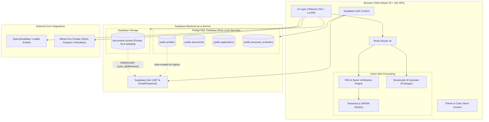

# SevaGuide (सेवागाइड)

> **Citizen Guidance Platform for Indian Public Services**  
> Navigating government services, verifying document readiness, and eliminating civic friction before you reach the counter.

[](https://react.dev/)
[](https://www.typescriptlang.org/)
[](https://vitejs.dev/)
[](https://tailwindcss.com/)
[](https://supabase.com/)
[](https://tesseract.projectnaptha.com/)

---

## 📌 Table of Contents

- [Overview](#-overview)
  - [The Problem](#the-problem)
  - [The SevaGuide Solution](#the-sevaguide-solution)
  - [Target Users and Impact](#target-users-and-impact)
- [Key Features](#-key-features)
  - [1. Comprehensive Services Catalog](#1-comprehensive-services-catalog)
  - [2. Three-Step Guided Service Journey](#2-three-step-guided-service-journey)
  - [3. Pre-Submission Document Verification & OCR Prototype](#3-pre-submission-document-verification--ocr-prototype)
  - [4. Citizen Document Vault & Application Tracking](#4-citizen-document-vault--application-tracking)
  - [5. Floating Quick-Access Toolbar](#5-floating-quick-access-toolbar)
  - [6. Global Color Vision Accessibility Suite](#6-global-color-vision-accessibility-suite)
  - [7. SevaGuide AI Civic Assistant Prototype](#7-sevaguide-ai-civic-assistant-prototype)
  - [8. Office Locator & Nearby Seva Kendras](#8-office-locator--nearby-seva-kendras)
- [System Architecture](#-system-architecture)
  - [Architecture Diagram](#architecture-diagram)
  - [Architecture Principles](#architecture-principles)
- [Technology Stack](#-technology-stack)
- [Getting Started & Local Setup](#-getting-started--local-setup)
  - [Prerequisites](#prerequisites)
  - [Step-by-Step Installation](#step-by-step-installation)
- [Environment Configuration](#-environment-configuration)
  - [Environment Variables](#environment-variables)
  - [Vite Environment Variable Architecture](#vite-environment-variable-architecture)
- [Supabase Backend Setup](#-supabase-backend-setup)
  - [1. Execute Schema Migration](#1-execute-schema-migration)
  - [2. Storage Bucket Configuration](#2-storage-bucket-configuration)
  - [3. Row Level Security (RLS) Policies](#3-row-level-security-rls-policies)
- [AI Assistant & Gemini Integration Roadmap](#-ai-assistant--gemini-integration-roadmap)
- [Deployment Guide (Vercel)](#-deployment-guide-vercel)
- [Document Verification Disclaimer](#-document-verification-disclaimer)
- [Project Directory Structure](#-project-directory-structure)
- [Available NPM Scripts](#-available-npm-scripts)
- [Security, Privacy & Compliance](#-security-privacy--compliance)
- [Contributing & License](#-contributing--license)

---

## 🌐 Overview

### The Problem

Every year, millions of Indian citizens visit government offices—such as **Lok Seva Kendras**, **Aadhaar Seva Kendras (ASK)**, **Regional Passport Offices (RPO)**, and **Regional Transport Offices (RTO)**—only to be turned away because of:

1. **Incomplete or incorrect documentation**: Missing a single supplementary certificate or submitting an unaccepted proof of address.
2. **Discrepant applicant details**: Subtle name spelling variations, date of birth mismatches, or address format discrepancies across documents.
3. **Confusion between online portals and physical counter requirements**: Unclear distinctions between what can be done entirely online versus services requiring in-person biometric capture.
4. **Bureaucratic cognitive load**: Navigating dense government gazettes and complex portals without clear, step-by-step guidance.

### The SevaGuide Solution

**SevaGuide (सेवागाइड)** is a citizen-first civic guidance platform built to bridge the gap between citizens and Indian public services. SevaGuide simplifies public services by providing:

- Clear eligibility rules, required vs. conditional document checklists, and transparent fee/timeline breakdowns.
- An automated pre-submission consistency check that identifies name spelling mismatches and date discrepancies before citizens visit facilitation centres.
- A unified personal document vault and application tracker backed by Supabase authentication and Row Level Security.
- An accessible, high-contrast, color-blind-friendly user interface designed for diverse demographics and varying digital literacy levels.

### Target Users and Impact

| Target Demographic | Primary Challenge Addressed | Value Delivered |
| :--- | :--- | :--- |
| **Everyday Citizens & First-Time Applicants** | Lack of clarity on mandatory vs. conditional documents | Step-by-step checklist preventing rejected applications |
| **Rural & Semi-Urban Applicants** | Long travel times to district headquarters | Offline preparation checklist ensures "First-Time Right" visits |
| **Elderly & Pension Scheme Applicants** | Complex multi-tier eligibility documentation | Dedicated workflows for IGNOAPS, IGNWPS, and IGNDPS |
| **Citizens with Visual Impairments** | Standard web platforms lack accessibility modes | 5 dedicated color vision modes (Protanopia, Deuteranopia, Tritanopia, High Contrast, AMOLED Dark) + text magnification |

---

## 🚀 Key Features

### 1. Comprehensive Services Catalog

SevaGuide indexes essential central government services and Chhattisgarh state welfare services with transparent fee breakdowns, processing durations, and official portal links:

- **Identity & Civil Registration**:
  - New Aadhaar Enrolment (Free, 15–30 days)
  - Aadhaar Update & Correction (Demographic & Biometric)
  - PAN Card Correction & Reprint (Income Tax Department / NSDL)
- **Travel & Passports**:
  - Fresh Indian Passport Application (Passport Seva Kendra workflow)
- **Chhattisgarh State Certificates**:
  - Domicile Certificate (*निवास प्रमाण पत्र*)
  - SC/ST Caste Certificate (*अनुसूचित जाति / जनजाति प्रमाण पत्र*)
  - OBC Caste Certificate (*अन्य पिछड़ा वर्ग प्रमाण पत्र*)
- **Social Security & National Pensions**:
  - Indira Gandhi National Old Age Pension Scheme (IGNOAPS)
  - Indira Gandhi National Widow Pension Scheme (IGNWPS)
  - Indira Gandhi National Disability Pension Scheme (IGNDPS)
- **Transport & Driving Licences**:
  - Learner's Licence (LL)
  - Permanent Driving Licence (DL)
  - Driving Licence Renewal
  - Duplicate Driving Licence

### 2. Three-Step Guided Service Journey

Each service detail page provides an interactive, structured 3-step workflow:

```
[ Step 1: Document Checklist ] ➔ [ Step 2: Upload & Verify ] ➔ [ Step 3: Choose Submission Mode ]
```

1. **Step 1: Document Readiness Checklist**
   - Interactive item-by-item checklist with real-time completion percentages.
   - Clear distinction between **Mandatory Documents** (e.g. Proof of Identity) and **Conditional Documents** (e.g. Proof of Date of Birth for verified DOB).
   - Local persistence via browser storage so users never lose progress on refresh.
   - Pre-flight warning modal alerting the user if they proceed with missing mandatory documents.

2. **Step 2: Upload & Verify Documents**
   - Upload documents directly to the private user vault.
   - Run automated pre-submission consistency evaluation.
   - Integrated deterministic verification testbed with pre-configured citizen scenarios.

3. **Step 3: Choose Submission Mode**
   - **Apply Online**: Direct links to authentic official government portals (UIDAI, Passport Seva, Parivahan Sewa, e-District) accompanied by an external redirect advisory modal.
   - **Visit Facilitation Centre**: In-person submission package with nearby seva kendra recommendations, required physical photocopies count, and office operational hours.

### 3. Pre-Submission Document Verification & OCR Prototype

SevaGuide includes an automated pre-submission verification engine designed to detect common documentation errors before submission:

- **Client-Side OCR Extraction via Tesseract.js**:
  - Processes uploaded JPEG/PNG documents directly in the citizen's browser using a WebAssembly Web Worker (`src/services/ocr.ts`).
  - Extracts text lines and character confidence ratings without sending sensitive images to third-party OCR APIs.
- **PAN Card Field Parser & Entity Validation**:
  - Extracts 10-character alphanumeric PAN numbers, cardholder names, father's names, and dates of birth (`src/services/panParser.ts`).
  - Validates PAN syntax and entity type (e.g., verifying the 4th character `P` denotes an individual).
- **Intelligent Name Token Comparison**:
  - Compares extracted document names with the applicant reference profile (`src/services/documentVerification.ts`).
  - Classifies name matches into `EXACT`, `PERMUTATION` (e.g., *Pandey Priyanshu* vs *Priyanshu Pandey*), `PARTIAL` (initials/abbreviations), or `MISMATCH`.
- **Deterministic Multi-Document Testbed (`DemoVerificationPanel`)**:
  - Built-in demonstration scenarios using fictional sample documents (`public/demo-documents/`):
    - **Scenario A (Full Match)**: Rahul Sharma's PAN Card, Class X Certificate, and Electricity Bill match identity, DOB, and address.
    - **Scenario B (Address Name Mismatch)**: Electricity bill issued in the name of *Prateek Agrawal* triggers a discrepancy warning against applicant *Rahul Sharma*, advising relationship proof or gazette declaration.

### 4. Citizen Document Vault & Application Tracking

When signed in via Supabase Authentication:
- **Encrypted Document Vault**: Uploaded identity and address documents are stored in user-isolated paths in the Supabase `documents` storage bucket.
- **Application Tracker**: Citizens can track ongoing applications, update their current workflow step index, review verification statuses (`pending`, `verified`, `warning`, `error`), and manage records.
- **Secure Deletion**: Double-confirmation deletion modals prevent accidental data loss.

### 5. Floating Quick-Access Toolbar

A persistent, responsive floating toolbar anchored to the bottom edge provides immediate civic utilities without navigating away from the current page:

- **Civic Calendar**: Displays official gazetted public holidays, tax deadlines, and Aadhaar update deadlines, synchronized with user-defined reminders stored in Supabase (`personal_reminders`).
- **User Feedback Drawer**: Star-rating and categorization feedback tool saving citizen reviews.
- **Accessibility Suite**: Direct controls for display magnification (80% to 150%) and color vision deficiency themes.
- **AI Assistant Trigger**: Instant shortcut to launch the SevaGuide civic assistant drawer.
- **Share Portal**: One-click URL clipboard copier with temporary confirmation toast.

### 6. Global Color Vision Accessibility Suite

SevaGuide implements a comprehensive color vision deficiency system engineered with CSS variables and synchronous DOM attributes:

- **Default Theme**: Saffron, navy, and emerald civic palette.
- **Protanopia-Friendly**: Replaces red/green conflict palettes with optimized blue, vermilion, and neutral tones.
- **Deuteranopia-Friendly**: Rebalances green-sensitive spectrums with high-contrast cobalt and amber hues.
- **Tritanopia-Friendly**: Adjusted blue/yellow contrast ensuring alerts and badges remain legible for tritanopic vision.
- **High Contrast Mode**: 7:1+ contrast ratios with crisp borders, pure black/white backgrounds, and distinct focus rings.
- **AMOLED Pitch Dark Mode**: Battery-saving, pure black `#000000` dark theme.
- **FOUC Prevention**: Synchronous pre-render script in `index.html` inspects `localStorage` and applies `data-vision-mode` and `.dark` before the first paint.

### 7. SevaGuide AI Civic Assistant Prototype

A context-aware slide-out assistant (`AIAssistantDrawer.tsx` powered by `src/services/ai.ts`):
- Provides instant answers regarding required documents, mismatch resolution, Gazette affidavit procedures, and office timings.
- Automatically inherits the active service context (e.g. informing the user specifically about PAN or Passport rules based on their current page).
- Implemented as a safe, client-side civic rules engine. *See [AI Assistant & Gemini Integration Roadmap](#-ai-assistant--gemini-integration-roadmap) for details on backend LLM architecture.*

### 8. Office Locator & Nearby Seva Kendras

- Comprehensive directory of facilitation centres across Chhattisgarh (Bhilai, Raipur, Durg, Bilaspur).
- Filters offices dynamically by service type (Aadhaar, Passport, Lok Seva Kendra, RTO).
- **Dual-Engine Map Integration**:
  - Embedded OpenStreetMap by default (zero API key dependency).
  - Optional Google Maps Embed API support when `VITE_GOOGLE_MAPS_API_KEY` is supplied.
  - Direct navigation links to Google Maps Directions for one-tap routing on mobile devices.

---

## 🏗️ System Architecture

### Architecture Diagram



### Architecture Principles

1. **Client-First Security**: Citizen documents uploaded to storage are isolated by PostgreSQL RLS policies where `auth.uid() = (storage.foldername(name))[1]`. No user can view or modify another citizen's files.
2. **Zero-Friction Fallback**: Core features—such as the service directory, readiness checklist, demo verification, and OpenStreetMap locator—operate completely client-side without mandatory backend logins or proprietary paid API keys.
3. **Static Build Inlining**: Supabase connection parameters are integrated via Vite's build-time `define` configuration, ensuring compatibility across cloud static hosting platforms like Vercel.

---

## 💻 Technology Stack

| Domain | Technology / Library | Version | Purpose |
| :--- | :--- | :--- | :--- |
| **Frontend Framework** | [React](https://react.dev/) | `^18.3.1` | Core declarative user interface library |
| **Language** | [TypeScript](https://www.typescriptlang.org/) | `^5.6.2` | Type-safe enterprise JavaScript |
| **Build Tool & Bundler** | [Vite](https://vitejs.dev/) | `^5.4.8` | Next-generation fast frontend tooling |
| **Styling & Design System** | [Tailwind CSS](https://tailwindcss.com/) | `^3.4.13` | Utility-first responsive CSS framework |
| **Icons** | [Lucide React](https://lucide.dev/) | `^0.344.0` | Accessible SVG icon suite |
| **Routing** | [React Router DOM](https://reactrouter.com/) | `^6.26.0` | Declarative client-side routing |
| **Backend & Database** | [Supabase](https://supabase.com/) | `^2.117.3` | Authentication, PostgreSQL with RLS, Private Storage |
| **Client OCR Engine** | [Tesseract.js](https://tesseract.projectnaptha.com/) | `^7.0.0` | In-browser WebAssembly OCR for image text extraction |
| **CSS Processing** | PostCSS & Autoprefixer | `^8.4.47` / `^10.4.20` | Vendor prefixing and CSS transformation |
| **Geospatial & Mapping** | OpenStreetMap / Google Maps | N/A | Interactive office location embeds and directions |

---

## 🛠️ Getting Started & Local Setup

### Prerequisites

Ensure you have the following installed on your machine:
- **Node.js**: `v18.0.0` or higher (LTS recommended)
- **npm**: `v9.0.0` or higher (comes bundled with Node.js)
- **Git**: For version control and cloning the repository

### Step-by-Step Installation

1. **Clone the repository:**
   ```bash
   git clone https://github.com/<your-username>/HackBios.git
   cd HackBios
   ```

2. **Install project dependencies:**
   ```bash
   npm install
   ```

3. **Configure environment variables:**
   Copy the example environment file:
   ```bash
   cp .env.example .env
   ```
   Open `.env` in your text editor and provide your Supabase project credentials:
   ```ini
   SUPABASE_URL=https://your-project.supabase.co
   SUPABASE_ANON_KEY=your-anon-key-here
   # Optional: Google Maps Embed API Key (Leave empty to use free OpenStreetMap)
   VITE_GOOGLE_MAPS_API_KEY=
   ```

4. **Initialize Supabase database:**
   Execute the migration SQL file located at [`supabase/schema.sql`](supabase/schema.sql) in your Supabase project's **SQL Editor**. *See [Supabase Backend Setup](#-supabase-backend-setup) for detailed steps.*

5. **Start the local development server:**
   ```bash
   npm run dev
   ```
   Open your browser and navigate to `http://localhost:5173`.

6. **Create a production build:**
   ```bash
   npm run build
   ```
   To test the production build locally:
   ```bash
   npm run preview
   ```

---

## 🔐 Environment Configuration

### Environment Variables

| Variable Name | Required | Description |
| :--- | :---: | :--- |
| `SUPABASE_URL` | **Yes** | Your Supabase project URL (`https://<project-ref>.supabase.co`). |
| `SUPABASE_ANON_KEY` | **Yes** | The public/anon API key for Supabase. Safe for client exposure under PostgreSQL RLS. |
| `VITE_GOOGLE_MAPS_API_KEY` | *Optional* | Google Maps Embed API key. If omitted, SevaGuide automatically uses OpenStreetMap. |

### Vite Environment Variable Architecture

Standard Vite applications only expose environment variables prefixed with `VITE_` to browser code via `import.meta.env`. To maintain clean variable naming (`SUPABASE_URL` and `SUPABASE_ANON_KEY`), SevaGuide's [`vite.config.ts`](vite.config.ts) is configured as follows:

```typescript
import { defineConfig, loadEnv } from 'vite';
import react from '@vitejs/plugin-react';

export default defineConfig(({ mode }) => {
  const env = loadEnv(mode, process.cwd(), '');
  const supabaseUrl = env.SUPABASE_URL || '';
  const supabaseAnonKey = env.SUPABASE_ANON_KEY || '';

  return {
    plugins: [react()],
    // Exposes variables starting with SUPABASE_ to import.meta.env
    envPrefix: ['SUPABASE_', 'VITE_'],
    define: {
      'import.meta.env.SUPABASE_URL': JSON.stringify(supabaseUrl),
      'import.meta.env.SUPABASE_ANON_KEY': JSON.stringify(supabaseAnonKey),
    },
  };
});
```

> [!NOTE]
> In Vite, client environment variables are **inlined into the static bundle during `npm run build`**. Whenever you update environment variables in your hosting provider (e.g. Vercel), you must trigger a **Redeploy** for the new values to take effect in the compiled bundle.

---

## 🗄️ Supabase Backend Setup

SevaGuide uses Supabase for user authentication, structured PostgreSQL data, and encrypted document storage.

### 1. Execute Schema Migration

Open the [Supabase Dashboard](https://supabase.com/dashboard) ➔ select your project ➔ navigate to **SQL Editor** ➔ click **New Query** ➔ paste and run the contents of [`supabase/schema.sql`](supabase/schema.sql).

This script idempotently provisions:

1. **`public.profiles`**: Stores citizen demographic details (`full_name`, `email`, `state`, `district`).
2. **`public.documents`**: Tracks uploaded citizen vault documents, OCR confidence scores, and extracted JSON metadata.
3. **`public.applications`**: Tracks citizen application workflows, current step indexes, and completion statuses.
4. **`public.personal_reminders`**: Stores personal calendar alerts and deadline notifications.
5. **`public.handle_new_user()` Trigger**: Automatically creates a record in `public.profiles` whenever a new citizen registers through Supabase Auth.

### 2. Storage Bucket Configuration

The migration automatically creates a private storage bucket named `documents`:
```sql
INSERT INTO storage.buckets (id, name, public)
VALUES ('documents', 'documents', false)
ON CONFLICT (id) DO NOTHING;
```

### 3. Row Level Security (RLS) Policies

All tables and storage objects have strict Row Level Security enabled:

- Citizens can **only select, insert, update, or delete** rows where `auth.uid() = user_id`.
- Storage objects enforce folder-level tenant isolation:
  ```sql
  CREATE POLICY "Users can upload their own documents to storage"
    ON storage.objects FOR INSERT
    TO authenticated
    WITH CHECK (
      bucket_id = 'documents' AND
      (storage.foldername(name))[1] = auth.uid()::text
    );
  ```
  Citizens cannot view or access another user's files even if they obtain the storage path.

---

## 🤖 SevaGuide AI Civic Assistant

SevaGuide incorporates a dedicated civic assistant (defaulting to the verified free model `google/gemma-4-31b-it:free`), accessible via the circular floating chatbot icon at the bottom-right and the quick-access toolbar.

### Architecture & Security

```
[ Citizen Browser (React SPA) ]
       │  POST /functions/v1/chat OR /api/chat
       │  (Masks Aadhaar/PAN PII locally)
       ▼
[ Supabase Edge Function (`supabase/functions/chat/index.ts`) ]
  OR [ Vercel Serverless Function (`api/chat.ts`) ]
       │  (Server-side secret: OPENROUTER_API_KEY)
       │  (Injects SevaGuide verified civic data & system prompt)
       ▼
[ AI Chat Completions Provider ]
```

### Security Highlights
- **Zero Frontend Secret Exposure**: The `OPENROUTER_API_KEY` is exclusively managed on the server side (Supabase Edge Function / Vercel Serverless). It is **never** prefixed with `VITE_` or bundled into browser assets.
- **Client & Server PII Masking**: Citizen input is scrubbed for 12-digit Aadhaar patterns and 10-character PAN patterns before being forwarded to the backend.
- **Accurate Civic Grounding**: The assistant inherits verified SevaGuide rules for Central and Chhattisgarh services (fees, required vs. conditional documents, official portal links).
- **Graceful Error Handling**: If the API key is not configured or rate limits are reached, the UI clearly displays actionable setup steps rather than fabricating simulated responses.

### How to Configure `OPENROUTER_API_KEY`

1. **Supabase Edge Function (Recommended)**:
   ```bash
   # Set your OpenRouter API key in Supabase Secrets
   supabase secrets set OPENROUTER_API_KEY=your-openrouter-api-key

   # Optional: Configure model (defaults to google/gemma-4-31b-it:free)
   supabase secrets set OPENROUTER_MODEL=google/gemma-4-31b-it:free

   # Deploy the chat edge function
   supabase functions deploy chat --no-verify-jwt
   ```

2. **Vercel Serverless Deployment**:
   - In your Vercel Project Dashboard, navigate to **Settings** ➔ **Environment Variables**.
   - Add `OPENROUTER_API_KEY` with your key from [OpenRouter](https://openrouter.ai/keys).
   - Optionally add `OPENROUTER_MODEL` (e.g. `google/gemma-4-31b-it:free`).
   - Redeploy the application.

3. **Local Development**:
   - Provide `OPENROUTER_API_KEY=your_key` in your server environment before running `npm run dev`. The Vite dev server securely handles `/api/chat` without exposing the key to the frontend.

---

## 🚀 Deployment Guide (Vercel)

SevaGuide is optimized for deployment on [Vercel](https://vercel.com/):

1. **Push your code to GitHub**:
   Ensure your latest code is committed and pushed to your GitHub repository on `main`.

2. **Import Project in Vercel**:
   - Go to your [Vercel Dashboard](https://vercel.com/dashboard).
   - Click **Add New...** ➔ **Project**.
   - Select your `HackBios` repository and click **Import**.

3. **Configure Project Settings**:
   - **Framework Preset**: `Vite`
   - **Root Directory**: `./`
   - **Build Command**: `npm run build`
   - **Output Directory**: `dist`

4. **Set Environment Variables**:
   Under **Environment Variables**, add:
   - `SUPABASE_URL` = `https://<your-project>.supabase.co`
   - `SUPABASE_ANON_KEY` = `<your-supabase-anon-key>`
   - *(Optional)* `VITE_GOOGLE_MAPS_API_KEY` = `<your-key-if-applicable>`

5. **Deploy**:
   Click **Deploy**. Vercel will run `tsc && vite build` and deploy the static SPA across its global edge network.

6. **Important Note on Environment Updates**:
   If you add or update `SUPABASE_URL` or `SUPABASE_ANON_KEY` in Vercel after the initial build, navigate to **Deployments** ➔ select the latest deployment ➔ click **Redeploy** to inline the updated variables into the client bundle.

---

## ⚠️ Document Verification Disclaimer

> [!IMPORTANT]
> **Prototype Demonstration Notice**  
> SevaGuide's automated document verification engine is a **client-side pre-submission consistency check** designed to help citizens identify discrepancies (such as spelling mismatches or missing proofs) before visiting government counters.
>
> **Legal & Administrative Disclaimer:**
> - SevaGuide **does not** authenticate official government databases or interface directly with internal government records (such as UIDAI CIDR, NSDL/UTIITSL databases, or the Income Tax Department).
> - Successful verification within SevaGuide does not guarantee acceptance by government authorities.
> - Citizens must always carry their original physical documents to authorized facilitation centres.
> - The sample documents provided in `public/demo-documents/` (for Rahul Sharma and Prateek Agrawal) are fictional representations created exclusively for evaluation and prototype testing.

---

## 📁 Project Directory Structure

```
HackBios/
├── .env.example                     # Sample environment variable template
├── .gitignore                       # Git ignore list (node_modules, .env, dist)
├── index.html                       # HTML entry point with FOUC theme pre-render script
├── package.json                     # Project manifest and dependencies
├── postcss.config.js                # PostCSS configuration for Tailwind CSS
├── tailwind.config.js               # Tailwind CSS theme and color tokens
├── tsconfig.json                    # TypeScript compiler configuration
├── vite.config.ts                   # Vite bundler configuration with SUPABASE_ envPrefix
├── public/                          # Static public assets
│   ├── favicon.svg                  # Platform favicon
│   ├── hero-banner.png              # Civic hero illustration
│   ├── hero-civic-bg.svg            # Hero background SVG vector
│   ├── logo.png                     # SevaGuide emblem logo
│   ├── sevaguide-logo.png           # Extended horizontal logo
│   └── demo-documents/              # Sample testbed documents for verification demo
│       ├── rahul_pan.jpeg           # Sample PAN (Rahul Sharma)
│       ├── rahul_10th.jpeg          # Sample 10th marksheet (Rahul Sharma)
│       ├── rahul_electricity.jpeg   # Sample electricity bill (Rahul Sharma)
│       ├── rahul_adhaar.jpeg        # Sample Aadhaar card (Rahul Sharma)
│       ├── prateek_pan.jpeg         # Sample PAN (Prateek Agrawal)
│       ├── prateek_10th.jpeg        # Sample 10th marksheet (Prateek Agrawal)
│       ├── prateek._electricity.jpeg# Sample electricity bill (Prateek Agrawal - mismatch)
│       ├── prateek_aadhar.jpeg      # Sample Aadhaar (Prateek Agrawal)
│       └── prateek_dl.jpeg          # Sample driving licence (Prateek Agrawal)
├── supabase/
│   └── schema.sql                   # Full PostgreSQL schema, triggers, and RLS policies
└── src/
    ├── main.tsx                     # React application root entry point
    ├── App.tsx                      # Route definitions and application shell
    ├── index.css                    # Tailwind CSS directives & color vision mode CSS
    ├── vite-env.d.ts                # TypeScript declarations for Vite client
    ├── components/                  # Reusable UI and civic components
    │   ├── AIAssistantDrawer.tsx    # Slide-out AI civic guidance drawer
    │   ├── AuthGuard.tsx            # Protected route wrapper for authenticated pages
    │   ├── BrandLogo.tsx            # Standardized brand logo component
    │   ├── CivicAlerts.tsx          # Real-time government alerts & announcements
    │   ├── CivicCalendar.tsx        # Gazetted holidays and deadline calendar
    │   ├── DeleteConfirmModal.tsx   # Double-confirmation modal for safe deletions
    │   ├── DemoVerificationPanel.tsx# Interactive verification scenario switcher
    │   ├── DocumentChecklist.tsx    # Step 1 interactive document readiness checklist
    │   ├── DocumentRequirementCard.tsx # Detailed document requirements card
    │   ├── DocumentUploader.tsx     # File upload dropzone with Tesseract OCR progress
    │   ├── ExternalPortalModal.tsx  # Advisory modal for external government links
    │   ├── FilePreviewModal.tsx     # In-browser image and document viewer
    │   ├── FloatingQuickAccessToolbar.tsx # Bottom floating toolbar (Calendar, Feedback, A11y)
    │   ├── Footer.tsx               # Application footer with links and helplines
    │   ├── Navbar.tsx               # Top navigation bar with theme and user controls
    │   ├── NearbySevaKendras.tsx    # Local Kendra locator cards
    │   ├── OfficeMap.tsx            # OpenStreetMap / Google Maps embed component
    │   ├── ProcessSteps.tsx         # Workflow step visual indicator
    │   ├── ProfileDropdown.tsx      # User account dropdown menu
    │   ├── ProfileHeader.tsx        # Profile summary header
    │   ├── ServiceCard.tsx          # Service directory card component
    │   ├── ServiceWorkflowSteps.tsx # 3-step progress breadcrumb (Checklist/Verify/Submit)
    │   ├── SubmissionModeStep.tsx   # Step 3 mode selector (Online Portal vs Physical Kendra)
    │   ├── UIFeedback.tsx           # Rating and feedback modal
    │   ├── UserApplications.tsx     # Citizen applications tracking list
    │   └── UserDocuments.tsx        # Citizen document vault viewer
    ├── context/                     # Global state contexts
    │   ├── AuthContext.tsx          # Supabase auth state provider
    │   └── ThemeContext.tsx         # Light/Dark and Color Vision accessibility provider
    ├── data/                        # Static datasets and service registries
    │   ├── applications.ts          # Sample application definitions
    │   ├── demoVerification.ts      # Deterministic demo scenarios (Scenario A & B)
    │   ├── holidays.ts              # Gazetted public holidays and tax deadlines
    │   ├── offices.ts               # Facilitation centre directory (Chhattisgarh)
    │   ├── services.ts              # Central & Chhattisgarh services catalog
    │   └── verification.ts          # Verification rule mappings
    ├── hooks/
    │   └── useCivicCalendar.ts      # Hook for managing holidays and personal reminders
    ├── layouts/
    │   └── MainLayout.tsx           # Root layout mounting Navbar, Footer, and Toolbar
    ├── lib/
    │   └── supabase.ts              # Supabase JS client initialization
    ├── pages/                       # Application view pages
    │   ├── Home.tsx                 # Landing page with hero, alerts, and quick links
    │   ├── Services.tsx             # Filterable and searchable services catalog
    │   ├── ServiceDetails.tsx       # 3-step service journey orchestrator
    │   ├── VerifyDocuments.tsx      # Standalone document verification screen
    │   ├── Applications.tsx         # Citizen applications tracking page
    │   ├── OfficeLocator.tsx        # Interactive facilitation centre map & directory
    │   ├── Profile.tsx              # Citizen profile and document vault
    │   ├── Login.tsx / Signup.tsx   # Authentication views
    │   └── About.tsx / FAQ.tsx / Contact.tsx / Feedback.tsx / PrivacyPolicy.tsx / TermsOfUse.tsx
    ├── services/                    # Business logic and external service integrations
    │   ├── ai.ts                    # Contextual civic AI guidance engine
    │   ├── documentVerification.ts  # Cross-document field consistency validator
    │   ├── maps.ts                  # Geospatial map embed and directions helper
    │   ├── ocr.ts                   # Tesseract.js in-browser OCR worker service
    │   ├── panParser.ts             # Indian PAN card parser and syntax evaluator
    │   └── sampleRegistry.ts        # Sample document registry
    └── types/                       # TypeScript interfaces and type definitions
        ├── calendar.ts              # Holiday, reminder, and calendar types
        └── index.ts                 # Service, document, office, and application types
```

---

## 📜 Available NPM Scripts

| Script | Command | Purpose |
| :--- | :--- | :--- |
| `npm run dev` | `vite` | Starts the Vite development server with Hot Module Replacement (HMR). |
| `npm run build` | `tsc && vite build` | Type-checks code with TypeScript and builds optimized production bundles into `dist/`. |
| `npm run lint` | `eslint . --ext ts,tsx` | Runs ESLint to identify code style and syntax issues. |
| `npm run preview` | `vite preview` | Locally serves the compiled production build from `dist/` to test before deployment. |

---

## 🔒 Security, Privacy & Compliance

- **No Secret Key Exposure**: Only the public Supabase `anon` key is bundled with the frontend. The privileged `service_role` key is **never** included in client-side code.
- **Row Level Security (RLS)**: PostgreSQL RLS policies guarantee that users can never query, insert, or modify another citizen's records or uploaded documents.
- **In-Browser OCR Processing**: When using client-side OCR via Tesseract.js, character recognition runs locally inside a WebAssembly Web Worker on the citizen's device. Images are not relayed to third-party OCR cloud services.
- **Credential Hygiene**: Local environment configurations (`.env`, `.env.local`) are strictly excluded in `.gitignore` to prevent credential leaks.

---

## 👥 Contributing & License

Contributions, feedback, and issue reports are welcome!

1. Fork the Project.
2. Create your Feature Branch (`git checkout -b feature/CivicFeature`).
3. Commit your Changes (`git commit -m 'Add CivicFeature'`).
4. Push to the Branch (`git push origin feature/CivicFeature`).
5. Open a Pull Request.

---

<p align="center">
  Built with ❤️ for <b>HackBios</b> | Empowering citizens with accessible, transparent public services.
</p>
